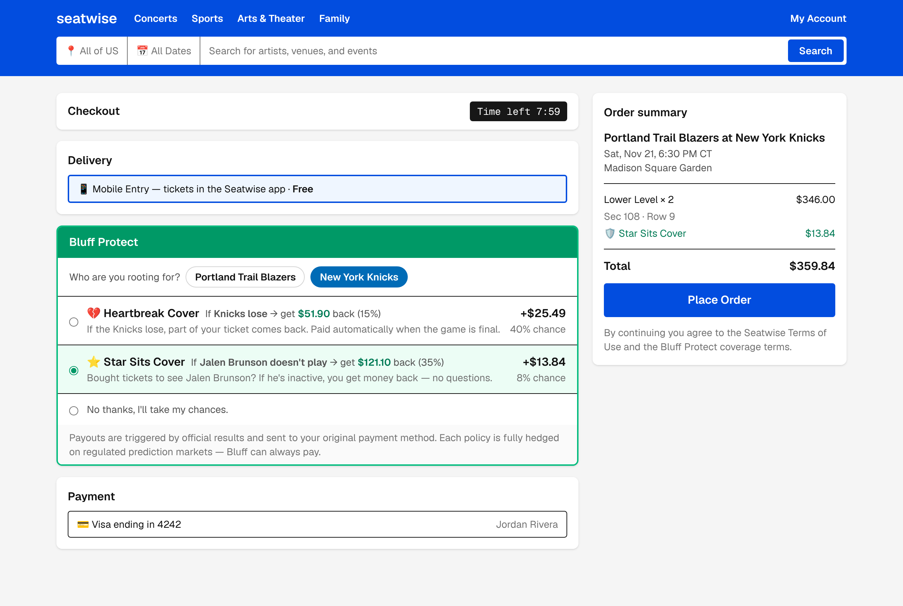
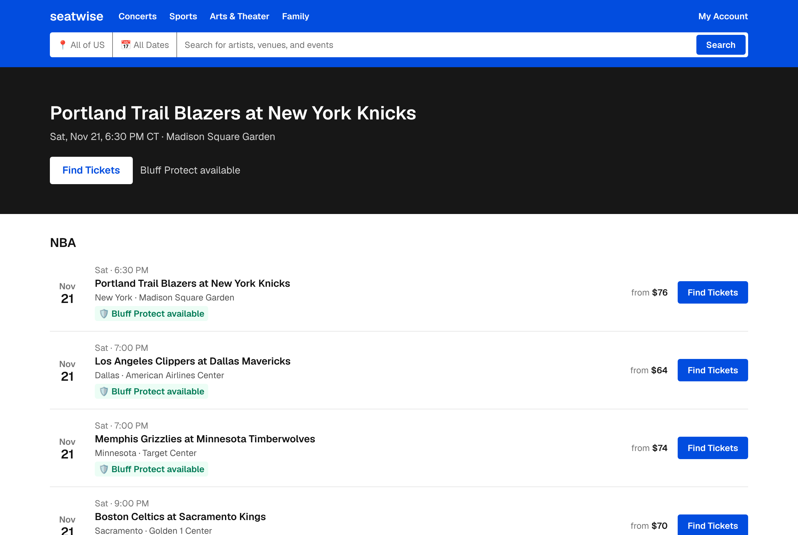
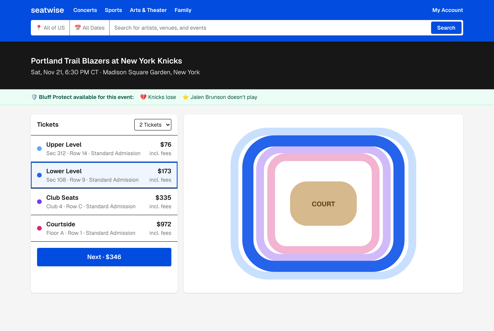
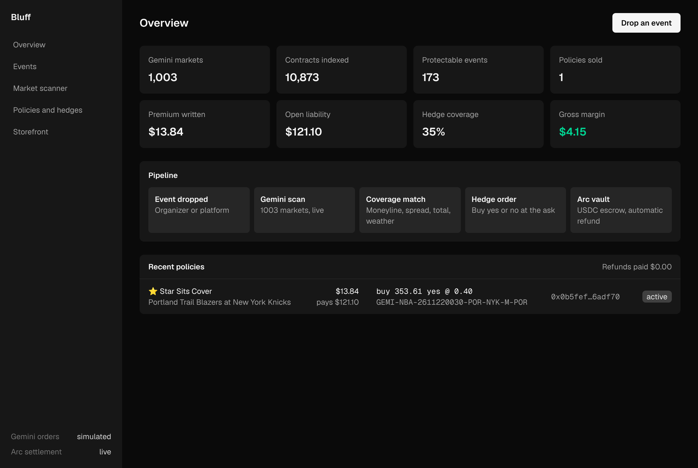
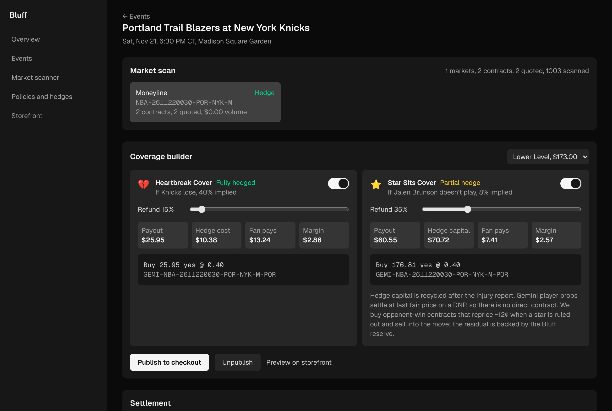
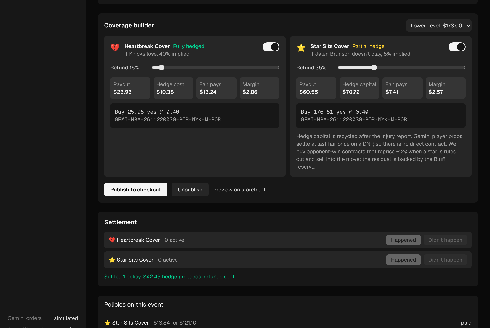
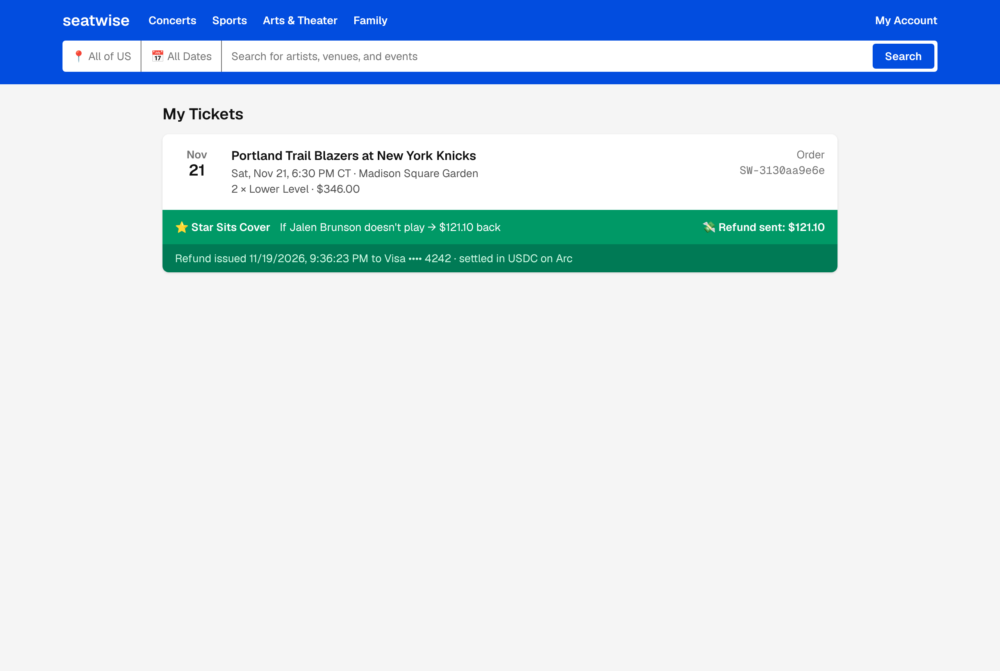
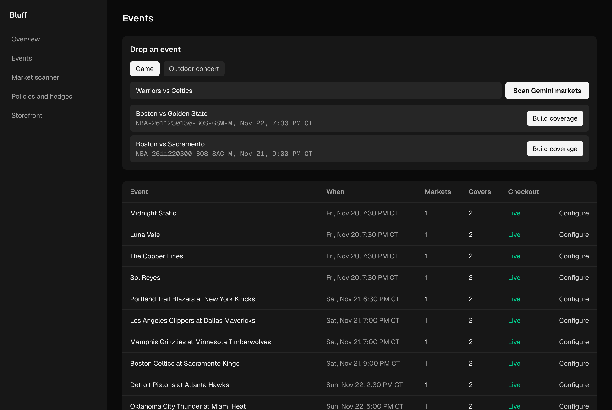
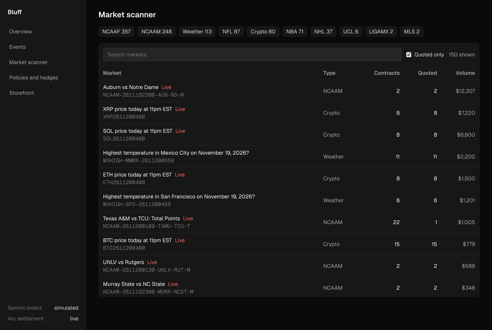

# Bluff

**Ticket protection for the nights that go wrong.** Your team gets blown out, the star sits, the outdoor show gets hit by a cold snap: you get money back automatically.

Every Bluff policy is **fully hedged on Gemini prediction markets** and **settled in USDC on Arc**. Bluff never carries the risk, and fans never touch crypto.

> UBC 2026 Hackathon · Consumer Apps track · Best use of Arc · Gemini Prediction Markets bounty



## How it works

1. **The fan adds protection at checkout.** Example: "Knicks lose → 15% of your $346 back" for a few dollars.
2. **We hedge on Gemini right away.** We buy the contract that pays $1 exactly when that outcome happens (here, *Portland YES*). One contract per $1 of payout means the book stays matched.
3. **The Arc vault pays out.** The premium is escrowed in USDC in `BluffProtectionVault`. When the Gemini market settles, the oracle calls `settleMarket()` and the vault refunds the fan.

**Margin** = premium − hedge cost. The premium is `hedgeCost × 1.18 + $0.99`, with a minimum of $1.99.

## Coverage catalog (mapped to real Gemini markets)

| Cover | Trigger | Gemini hedge | Hedge type |
|---|---|---|---|
| 💔 Heartbreak | your team loses | opponent **moneyline YES** | full |
| 🧯 Blowout | lose by 13+ (NBA) / 14+ (NFL) | "Opp wins by more than N.5" **spread YES** (nearest quoted strike) | full |
| 😴 Snoozer | combined score ≤ X | "More than X scored" **total NO** | full |
| ⭐ Star Sits | named star doesn't play | opponent moneyline YES, sized as a proxy (delta) hedge | **partial** |
| 🥶 / 🥵 Weather | city daily high ≤ / ≥ X °F (outdoor concerts) | NWS daily-high bucket **YES** | full |

"Star sits" is a partial hedge for a reason: Gemini player props settle at the *last fair price* on a DNP, so no contract pays directly when a player sits. We buy opponent-win contracts, which reprice when the star is ruled out, and the Bluff reserve backs the remaining risk. The console states this next to the cover.

## Architecture

```
            ┌──────────── Seatwise storefront (fan) ────────────┐
            │ event page → seats → checkout + Bluff Protect     │
            └───────────────┬───────────────────────────────────┘
                            │ /api/quote, /api/policies
┌─ Bluff Console (org) ─┐   ▼
│ drop event → scan →   │  Next.js API (server)
│ coverage builder →    │──► lib/gemini/client   public events API, ~1000 markets, 60s cache, snapshot fallback
│ publish → settle      │──► lib/coverage        matcher + pricing (event → markets → covers → quote)
└───────────────────────┘──► lib/gemini/trading  hedge executor (HMAC-signed POST /v1/prediction-markets/order; simulated w/o keys)
                        ──► lib/arc/client       viem → BluffProtectionVault on Arc testnet (simulated w/o key)
                        ──► lib/store            JSON store (policies, offers, custom events)

contracts/BluffProtectionVault.sol   purchasePolicy · depositHedgeProceeds · settleMarket (oracle) · withdrawSurplus
```

- **Market data is live**: `api.gemini.com/v1/prediction-markets/events` is public. There's a 3.5 MB snapshot in `web/data/` so the demo still works offline.
- **Hedge orders** go out live when `GEMINI_API_KEY` and `GEMINI_API_SECRET` are set. Without them, we build the same order payload and record a simulated fill.
- **Arc is live on testnet.** `BluffProtectionVault` is deployed at [`0xfab42bf0ea82413d078af58712ef31a43b7ccec8`](https://testnet.arcscan.app/address/0xfab42bf0ea82413d078af58712ef31a43b7ccec8) (chain 5042002). Every checkout calls `purchasePolicy`, and every settlement calls `depositHedgeProceeds` and `settleMarket` with real transactions. On-chain amounts are recorded at 1/100 of the USD figures (`ARC_AMOUNT_SCALE`) to fit testnet faucet limits. Without `ARC_OPERATOR_KEY`, the app falls back to simulated txs with the same policy and market hashes. To redeploy: `cd contracts && NODE_USE_ENV_PROXY=1 node scripts/deploy-viem.mjs` (or `npm run deploy:arc`).

The full product spec is in [`docs/PRD.md`](docs/PRD.md).

## Run it

```bash
cd web && npm install && npm run dev      # http://localhost:3000
npm test                                   # coverage/pricing engine tests (6)
cd ../contracts && npm install && npx hardhat test   # vault tests (14)
```

Pages: `/` landing · `/seatwise` storefront · `/seatwise/account` fan policies · `/console` overview · `/console/events` drop an event · `/console/events/[id]` scan + coverage builder + settlement · `/console/scanner` all Gemini markets · `/console/policies` hedge orders and Arc txs.

## Screenshots

| | |
|---|---|
|  |  |
|  |  |
|  |  |
|  |  |
