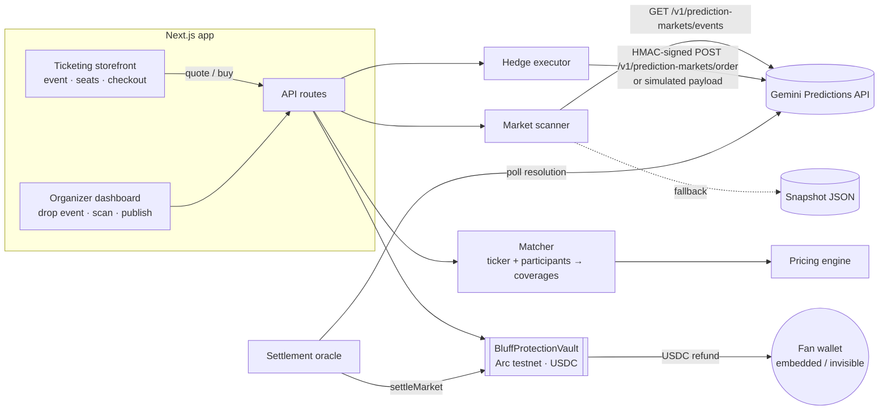

# Bluff — PRD

> **Ticket protection for the night going wrong.** If your team gets blown out, the star sits, or it's 100°F at the festival, you get part of your ticket back automatically. Every policy is hedged 1:1 on Gemini prediction markets and paid out in USDC on Arc.

| | |
|---|---|
| Status | Hackathon MVP (UBC 2026) |
| Deadline | **Fri Nov 20, 12:00 PM CST** (Devpost) |
| Submission | Public repo · README + architecture · working demo · 2–3 min video |
| Targets | Consumer Apps track · Best use of Arc · Gemini Prediction Markets bounty · Official Winner |

---

## 1. Problem

- Fans spend $100–$1,000+ on a ticket for a *specific experience*: watching the star, seeing their team win, an outdoor show in good weather. Today's "ticket insurance" covers only *the fan* failing to attend (illness, travel). It never covers *the event* disappointing.
- Venues and ticketing platforms can't offer experience-based refunds, because they would carry that risk on their own balance sheet.
- Prediction markets already price these exact outcomes (who wins, margin of victory, total points, daily high temperature), but fans will never open an exchange account to hedge a ticket.

**Bluff turns liquid prediction-market contracts into one-click, parametric ticket add-ons.** We never carry the risk: each policy is backed by a matching contract bought the moment the fan pays.

---

## 2. Users

| User | Surface | Job to be done |
|---|---|---|
| **Ticketing platforms / organizers (primary, B2B)** | Bluff Dashboard | Drop in an event, see which protections can be hedged, set the margin, publish offers to checkout, monitor exposure and payouts |
| **Fans (B2C)** | Checkout add-on on the ticketing site, plus "My Policies" | Add protection in one tap, pay in their normal currency, and get an automatic refund (USDC/stablecoin under the hood, invisible to them) |

The organizer earns a revenue share on each add-on, and Bluff keeps the remaining margin. Hackathon demo: a mock ticketing storefront modelled on major ticketing checkout flows, under a fictional brand, plus the Bluff dashboard.

---

## 3. What Gemini actually offers (live scan, Nov 19 2026)

Public `GET /v1/prediction-markets/events?status=active`, no key required:

| Category | Events | Notes |
|---|---|---|
| Sports | 802 | NCAAF 361 · NCAAM 238 · NFL 89 · NBA 71 · NHL 33 · UCL/Liga MX/MLS 10 |
| Weather | 118 | Daily high-temp buckets across ~60 cities (Austin, NYC, LA, Chicago, London…) |
| Crypto | 79 | BTC/HYPE price buckets |
| **Total** | **999 events / ~10.9k contracts** | **No concert or artist markets** |

Sports market types: Moneyline (`-M`), Point Spread (`-S`), Total Points (`-T`), quarter/half lines, and player props (points, rebounds, assists, pass/rush/rec yards, TDs).

**Ticker format:** `LEAGUE-YYMMDDHHMM-AWAY-HOME-{TYPE}`, e.g. `NFL-2611260100-GB-LAR-M`, where the timestamp is the UTC start time (also given in `startTime`). Each contract carries `instrumentSymbol` (e.g. `GEMI-NCAAM-2611200100-TAMU-TCU-M-TCU`), `prices.buy.yes`/`.no`, `bestBid`/`bestAsk`, and settlement rules text.

**Two constraints that shape the product:**
1. **Player props do not pay "No" on a DNP.** The rules say: *"If the player records no playing time… the Contract resolves to the last fair price."* So "star sits out" **cannot be hedged 1:1** and needs a proxy hedge (see §4.1).
2. **Liquidity is uneven.** On a typical spread ladder only 1–5 of ~30 thresholds have a live ask. Pricing must fall back to the nearest liquid strike (§5.2).

---

## 4. Coverage catalog

Every protection uses this shape: **trigger → refund % of ticket → hedge = buy YES on the matching contract, quantity = payout ÷ $1.**

### 4.1 Sports (NBA / NFL / NHL / NCAA)

| Protection | Fan-facing trigger | Gemini market | Contract (side) | Hedge quality |
|---|---|---|---|---|
| **Heartbreak** | "My team loses → 30% back" | Moneyline `…-M` | Opponent wins (YES) | **Full** (1:1) |
| **Blowout** | "My team loses by 10+ → 50% back" | Point Spread `…-S` | "Opponent wins by more than 9.5 points" (YES) | **Full** |
| **Snoozer** | "Under 210 total points → 25% back" | Total Points `…-T` | "More than 209.5 points scored" (**NO**) | **Full** |
| **Star Sits** | "Star doesn't play → 40% back" | Moneyline `…-M` | Opponent wins (YES), sized by hedge ratio | **Partial**, labelled in the UI |

**Example (live market):** Golden State vs Memphis, `NBA-2611200100-GSW-MEM-S`, contract `MEM9` "Memphis wins by more than 9.5 points". A Warriors fan with a $150 ticket buys Blowout cover at 50% → $75 payout → buy **75 MEM9 YES** contracts.

**Star Sits (proxy/delta hedge).** When a star is ruled out, the opponent's moneyline jumps (e.g. 40¢ → 60¢). Bluff buys opponent YES at policy purchase. If the star sits, it sells (or holds) the position and the gain funds refunds. Hedge ratio: `contracts = payout / Δp_expected`, where `Δp_expected` is the estimated price impact of the star's absence (for the MVP, a per-player constant such as 0.15–0.25). Basis risk is reserved in the vault and shown to organizers as a **"partial hedge"** badge with the residual exposure in USDC.

### 4.2 Concerts & festivals (outdoor venues)

| Protection | Trigger | Gemini market | Contract (side) |
|---|---|---|---|
| **Heatwave** | "Venue city high ≥ 95°F → 30% back" | `WXHIGH-{CITY}-…` | Top bucket(s), e.g. "94°F or above" (YES). Several buckets = several legs |
| **Cold Snap** | "High ≤ 45°F → 30% back" | `WXHIGH-{CITY}-…` | Bottom bucket "X°F or below" (YES) |

Settlement source is the NWS Daily Climatological Report for the city's airport station. The venue must be in one of the ~60 covered cities, and the market must exist for the show date (markets are listed about 1–2 days ahead, so the policy is quoted early and the hedge fills once the market lists).

### 4.3 Future coverage (adapters)

- **Cancellation / postponement / headliner no-show:** Kalshi and Polymarket adapters behind the same `MarketSource` interface.
- **Overtime / buzzer-beater "bonus" protection:** quarter and half lines already on Gemini.
- **Bundles:** "Bad Night" = Heartbreak + Snoozer at a discount (correlated legs, priced jointly).

---

## 5. Pricing

### 5.1 Formula

```
payout        = ticketPrice × refundPct
contracts     = payout / $1.00            (each YES pays $1 at settlement)
hedgeCost     = contracts × bestAsk       (YES ask, or NO ask for "under" covers)
premium       = hedgeCost × (1 + margin) + fixedFee
```
Defaults: `margin = 10%`, `fixedFee = $0.50`. The margin is split between Bluff and the organizer (dashboard setting, default 50/50).

**Worked example (from the spec):** $150 ticket, 50% refund → payout **$75** → 75 contracts at **$0.20** ask → hedge **$15.00** → premium = 15.00 × 1.10 + 0.50 = **$17.00**.

**Low-probability example:** the same $75 payout at a $0.07 ask → hedge $5.25 → premium **$6.28**. That is the "$6 add-on" fans see on a favourite-team blowout cover.

The fan sees "**$6.28 — get $75 back if the Warriors lose by 10+**". If the fair hedge cost is above a configurable cap (default: premium > 35% of payout), the offer is hidden because it's too expensive to be appealing.

### 5.2 Illiquid strikes

1. Scan the contract ladder for the requested threshold (for example 9.5).
2. If it has no ask, choose the **nearest liquid strike that is at least as hard to trigger for us**. For "lose by 10+" that means the nearest liquid threshold ≤ 9.5, so the hedge pays whenever the policy pays.
3. Restate the fan trigger to match the hedged strike exactly ("lose by 8+" if MEM7 is the liquid one). Policy and hedge never diverge.
4. Use the ask (not last trade or mid). Cap quantity at visible depth, and if depth runs out, cap the policies sold.
5. If nothing on the ladder is liquid, show the coverage as **"unavailable"** in the dashboard with the reason.

---

## 6. System architecture



| Component | Responsibility |
|---|---|
| **Market scanner** | Pages through all active events (`limit=100&offset=…`). Caches for 60s. Falls back to a committed snapshot when offline. Normalizes events into `{league, startTime, home, away, type, contracts[]}` |
| **Matcher** | Given an event (teams + date, or venue city + date), finds candidate markets by parsing the ticker (`LEAGUE-YYMMDDHHMM-AWAY-HOME-TYPE`) and `participants[]`, then maps them to coverage templates (§4). Rule-based and deterministic; an LLM is optional for free-text events |
| **Pricing engine** | Applies §5: liquidity fallback, premium, availability, and the expected value shown to organizers |
| **Hedge executor** | **Live mode** (keys present): HMAC-SHA384-signed private API (`X-GEMINI-APIKEY`, `X-GEMINI-PAYLOAD`, `X-GEMINI-SIGNATURE`), places a limit order at the ask on the instrument symbol. **Sim mode** (no keys): builds and logs the exact order payload and records a simulated fill at the ask |
| **BluffProtectionVault (Arc)** | USDC escrow and policy registry. `purchasePolicy(policyId, marketKey, payout, premium)` pulls the premium. `depositHedgeProceeds(marketKey, amount)` lets the operator top up the vault from hedge winnings. `settleMarket(marketKey, triggered)` is oracle-only and pays every triggered policy its payout in USDC, or marks it expired. Events: `PolicyPurchased`, `MarketSettled`, `PolicyPaid` |
| **Settlement oracle** | Polls Gemini for market resolution, then calls `settleMarket`. For the MVP it is a single trusted signer. Gemini's settled value is the source of truth |

**Money flow:** fan pays premium (USDC into the vault) → backend buys the hedge on Gemini → event happens → Gemini settles and pays $1 per contract to the Bluff account → operator calls `depositHedgeProceeds` → oracle calls `settleMarket` → the vault pays fans. Fans need no wallet knowledge: they get an embedded wallet and a "refund sent" notification.

---

## 7. User flows

**Organizer (dashboard)**
1. **Drop event:** pick from a live Gemini-backed list, or enter teams/venue + date.
2. **Scan:** the scanner and matcher show matching markets ("4 markets, 112 contracts, 9 liquid").
3. **Select coverages:** toggle Heartbreak / Blowout / Snoozer / Star Sits / Heatwave, set refund %, margin and price cap, and preview the premium per ticket tier plus hedge quality.
4. **Publish:** offers go live at checkout. Then **monitor:** policies sold, premium collected, hedge positions, open exposure, and settlements.

**Fan (storefront)**
1. Event page → pick section/seats → checkout.
2. **"Protect your night"** card: one-tap add-ons with plain-English triggers and the price ("+$6.28 — 50% back if the Warriors lose by 10+").
3. Pay → policy confirmation (policy ID, trigger, payout; the Arc tx link sits behind "details").
4. **My Policies:** live status (Active → Settling → **Refund sent $75** or Expired).

---

## 8. Hackathon mapping

| Prize | Why we qualify | Evidence in demo |
|---|---|---|
| **Consumer Apps track** ($2k) | Crypto is invisible: fans buy a checkbox and get a refund | Storefront checkout + My Policies |
| **Best use of Arc** ($1k) | USDC-native escrow, policy registry and automatic payouts on Arc testnet | Vault contract address, purchase/settle txs |
| **Gemini Prediction Markets** ($2.5k / $1k / $500) | The whole product runs on Gemini's predictions API: a live scan of ~1k events, pricing from live asks, hedge orders | Dashboard scan view, quote breakdown, order payloads |
| **Official Winner** | Auto-entered | — |
| ElevenLabs / QuickNode Streams / Grok Bot | Out of scope unless time remains (for example a voice "refund sent" call, or Streams watching vault events) | — |

---

## 9. Risks & mitigations

| Risk | Mitigation |
|---|---|
| **Basis risk** (Star Sits proxy; strike mismatch) | Full-hedge covers restate their trigger to the exact hedged strike. Star Sits is labelled "partial", carries a vault reserve, and has a per-event exposure cap |
| **Liquidity** (thin ladders, wide spreads, depth) | Price at the ask, cap policies at visible depth, hide offers over the price cap, mark coverage "unavailable" |
| **Hedge execution lag** (price moves between quote and fill) | Quotes last 30s. Use limit orders at the quoted ask; if unfilled, refund the premium and void the policy |
| **Regulatory** | Parametric event protection may count as insurance in some states, or as a swap/event contract. Open questions: whether to partner with a licensed insurer (MGA model) or carrier, or structure it as a warranty/refund promise funded by hedges, plus state-by-state filings. The hackathon MVP runs on testnet only |
| **Oracle trust** | MVP: a single signer that mirrors Gemini's official resolution, with every settlement on-chain and auditable. Later: multisig or a Gemini-signed attestation |
| **Gemini settlement disputes / "last fair price"** | Don't sell full-hedge covers on markets with fair-price fallbacks. Delay settlement until Gemini's final resolution. If a game is cancelled or postponed (> 7 days), refund premiums |
| **Counterparty / custody** (funds on Gemini) | Keep the hedge book small relative to the vault, sweep winnings to the vault promptly, and publish reserves |

---

## 10. Milestones

**Tonight (MVP, before Fri 12:00 PM CST)**
- [ ] Live Gemini scanner + snapshot fallback
- [ ] Matcher + coverage templates (Heartbreak, Blowout, Snoozer, Star Sits [partial], Heatwave/Cold Snap)
- [ ] Pricing engine with liquidity fallback
- [ ] Organizer dashboard: drop event → scan → select → publish → monitor
- [ ] Storefront: event page → seats → checkout add-on → My Policies → refund state
- [ ] Hedge executor in sim mode (exact Gemini order payloads); live mode wired behind env keys
- [ ] `BluffProtectionVault` Solidity + tests; Arc testnet deploy script (needs a funded wallet)
- [ ] README with architecture, plus the demo video (recorded by the team)

**Post-hackathon**
- Live Gemini hedging with real keys; automated proceeds sweep
- Kalshi/Polymarket adapters (cancellations, concerts, awards)
- Correlated bundle pricing; per-player Star Sits models built from historical injury-news price moves
- Embedded wallets + fiat on-ramp; organizer revenue-share payouts
- Licensing path (MGA/carrier partner)

---

## 11. Open questions

1. **Gemini API keys:** a team account with prediction-market terms accepted (needed for live hedge orders). Until then, sim mode.
2. **Arc deploy:** a wallet funded from Circle's Arc testnet faucet, plus the testnet USDC address to wire into the vault.
3. **Naming:** "Bluff" as the product name? What fictional brand should the demo storefront use?
4. **Star Sits sizing:** a per-player constant Δp for the MVP, or skip it from checkout and show it only in the dashboard?
5. **Pricing defaults:** margin 10% / fee $0.50 / cap 35% of payout. Validate against conversion intuition.
